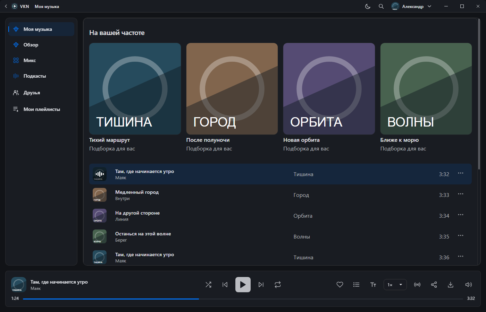
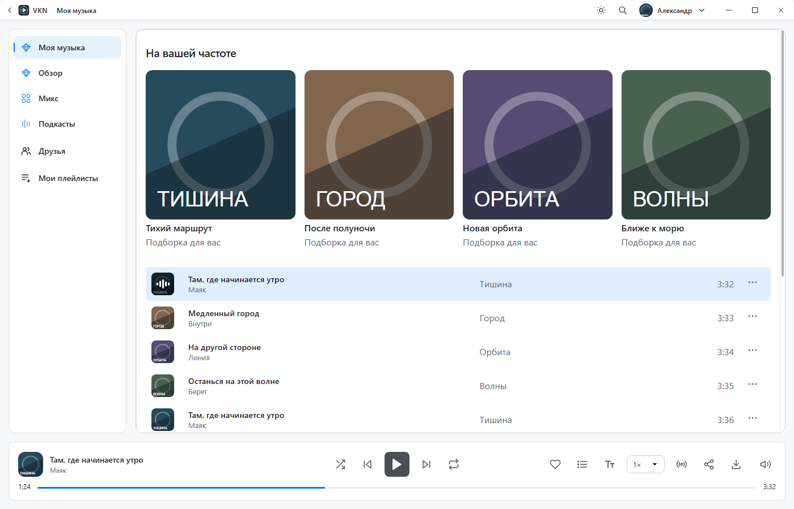
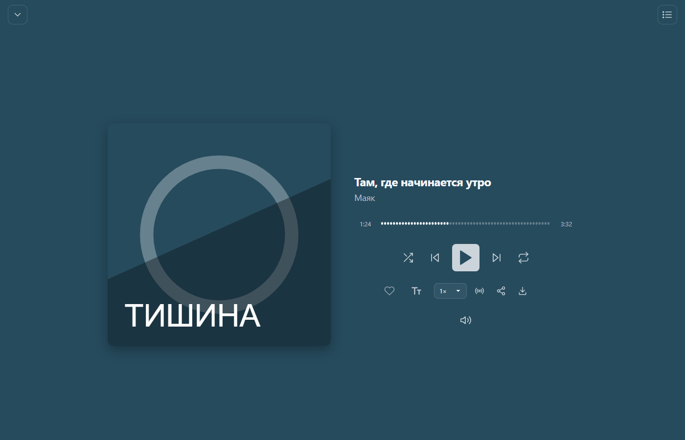
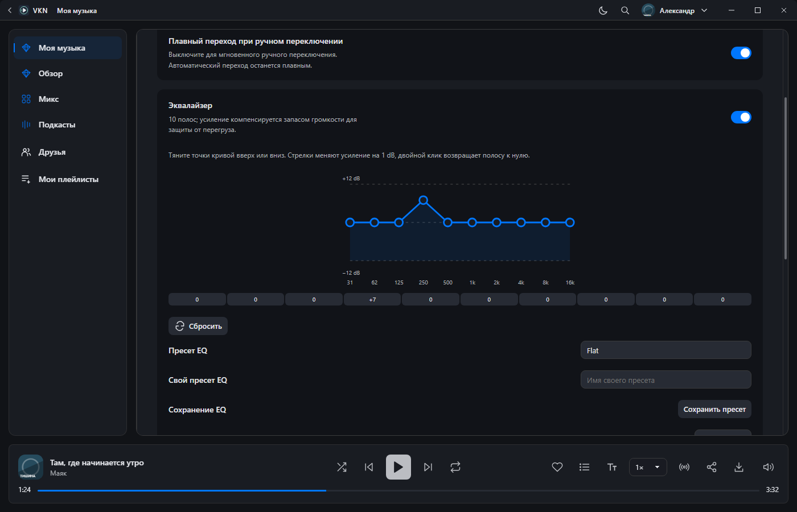
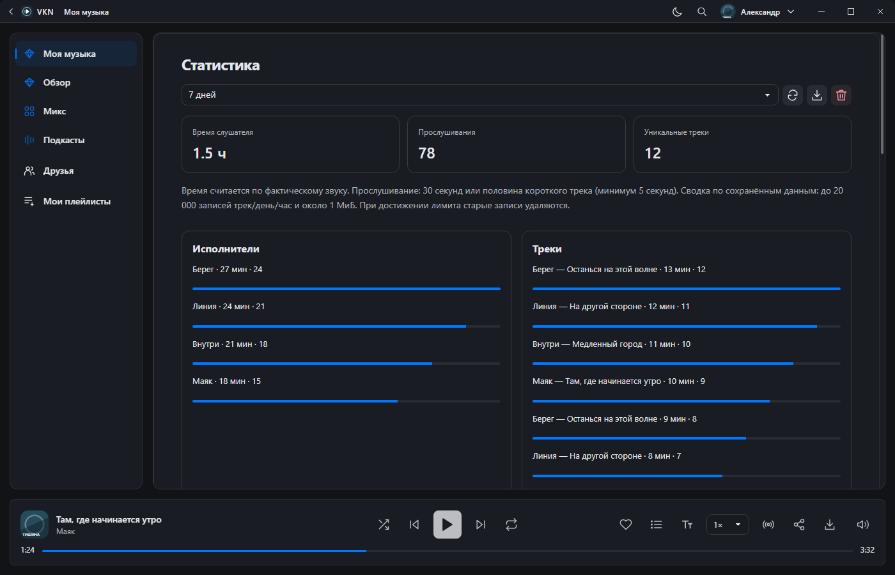

# VKN

Музыкальный плеер для ВКонтакте на **Windows и Linux**. Самостоятельный desktop-клиент с библиотекой, очередью, настройкой звука и локальным сохранением музыки.

**[Скачать последнюю версию](https://github.com/gr4shin/vkn/releases/latest)** · [Все релизы](https://github.com/gr4shin/vkn/releases) · [Приватность](PRIVACY.md) · [Условия использования](TERMS.md)

## Что умеет

- Библиотека VK, поиск, плейлисты, страницы исполнителей и музыкальный каталог.
- VK Микс, очередь с историей, перемешивание и восстановление сеанса.
- Большой плеер, тексты песен, управление мультимедийными кнопками.
- Эквалайзер на 10 полос, пресеты, скорость, плавные переходы и таймер сна.
- Сохранение доступных треков для офлайн-прослушивания и экспорт в MP3.
- Светлая, тёмная и AMOLED темы, настройки внешнего вида и компактное окно.
- Локальная статистика прослушиваний для самого пользователя.
- Дополнительные интеграции: Discord Rich Presence и трансляция трека в VK.

Доступность музыки, рекомендаций, входа и других сетевых функций зависит от VK, аккаунта, региона и ответов сервиса. Изменения VK могут временно нарушать работу приложения. Для офлайн-прослушивания требуется заранее сохранённая музыка. Поддержка карточек аудиокниг пока не включает воспроизведение глав.

## Скачать и запустить

В [последнем релизе](https://github.com/gr4shin/vkn/releases/latest) выберите файл для своей системы:

| Система | Файл | Назначение |
| --- | --- | --- |
| Windows x64 | `VKN-<версия>-win-x64-setup.exe` | Установщик |
| Windows x64 | `VKN-<версия>-win-x64-portable.exe` | Запуск без установки |
| Linux x64 | `VKN-<версия>-linux-x86_64.AppImage` | AppImage; разрешите выполнение файла |

В релизах также есть `SHA256SUMS.txt` для проверки файлов и `release-metadata.json` с версией и коммитом сборки. Portable означает отсутствие установки; приложение всё равно сохраняет локальный профиль.

После запуска войдите в свой аккаунт VK предусмотренным в приложении способом. Используйте музыку в соответствии с доступом своего аккаунта и правами правообладателей.

## Интерфейс

Снимки получены из настоящего интерфейса Electron на демонстрационных данных. Это вымышленные треки, обложки и профиль; фотографии и библиотека реального пользователя не используются.

Светлая тема

Большой плеер

Эквалайзер

Статистика, которая остаётся на устройстве

## Данные и автономность

Автор не собирает через VKN удалённую аналитику, телеметрию или историю прослушиваний. В приложение не встроена автоматическая отправка пользовательских данных на сервер автора.

VKN работает самостоятельно: запросы авторизации и музыки направляются непосредственно в VK, медиа загружаются с адресов, предоставленных сервисом.

Настройки, очередь, закрепления, локальная статистика и кэш остаются на вашем устройстве. Сессия текущего формата сохраняется с использованием системного защищённого хранилища Electron; остальные локальные данные не имеют общего шифрования. Локальная статистика включена по умолчанию и отключается в настройках хранения.

При включении Discord выбранные сведения о прослушивании передаются клиенту Discord. При включении трансляции в VK сведения о текущем треке отправляются в VK. Диагностические логи выключены по умолчанию; экспорт сохраняет файл локально, а отправлять его автору решает пользователь.

Подробности о получателях, хранении, удалении и ограничениях защиты: **[PRIVACY.md](PRIVACY.md)**.

## Использование на свой риск

Приложение предоставляется «как есть», без обещаний бесперебойной работы, совместимости с будущими изменениями VK или отсутствия ошибок. Вы используете его на свой риск, в пределах, допускаемых применимым законодательством. Полные условия: **[TERMS.md](TERMS.md)**.

VKN — независимый проект, не официальный продукт VK. Название VKN используется как название проекта; зарегистрированный товарный знак не заявляется. Права на музыку, изображения, названия VK и другие сторонние материалы принадлежат соответствующим правообладателям.

## Разработка и вклад

Проект создаётся **gr4shin при значительном участии OpenAI Codex**. Большая часть реализации, рефакторинга и проверок выполняется с помощью ИИ; идея, направление развития, решения и выпуск — за gr4shin. Проект не представляется как работа, выполненная автором полностью в одиночку.

Codex используется при разработке. В установленный VKN не встроено взаимодействие с OpenAI или отправка туда данных пользователей.

Исходный код VKN пока закрыт. Этот GitHub-репозиторий содержит готовые релизы, описание, снимки интерфейса и документы для пользователей.

## Права и сторонние компоненты

© 2026 gr4shin. Все права на собственные материалы проекта сохранены. Условия использования официальных сборок: [LICENSE](LICENSE) и [TERMS.md](TERMS.md).

Сторонние компоненты распространяются по своим лицензиям, включая GPL-компонент FFmpeg: [THIRD_PARTY_NOTICES.md](THIRD_PARTY_NOTICES.md). Условия VKN не заменяют их лицензии.

## Сообщить о проблеме

Откройте [Issue](https://github.com/gr4shin/vkn/issues) с версией, системой и шагами воспроизведения. Не публикуйте токены VK, QR-коды входа, файлы сессии или полные дампы аккаунта. Если решите приложить диагностический файл, сначала проверьте его содержимое: Issue и вложения могут быть публичными.
