

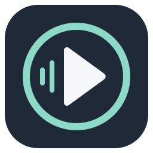

# VKN

### Ваша музыка. С аккаунтом VK и без него.

Локальные файлы и музыка ВКонтакте в одном плеере — с общей очередью, офлайн-библиотекой и настройкой звука.

**[Скачать VKN](https://github.com/gr4shin/vkn/releases/latest)** · [Что нового](https://github.com/gr4shin/vkn/releases) · [Сообщить о проблеме](https://github.com/gr4shin/vkn/issues) · [Discord](https://discord.gg/H7CePVp4vS)

[Возможности](#что-умеет) · [Установка](#скачать-и-запустить) · [Интерфейс](#интерфейс) · [Конфиденциальность](PRIVACY.md)

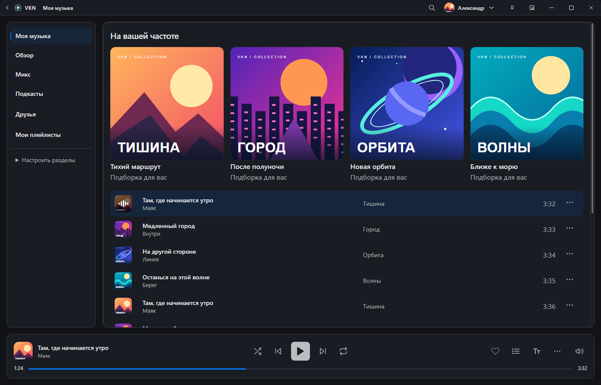

## Музыка начинается без входа

Откройте аудиофайлы или папку, перетащите музыку в окно и слушайте. Подключите VK, когда захотите добавить свою сетевую библиотеку: локальные и VK-треки работают в общей очереди.

| Без аккаунта | С музыкой VK | На ваших устройствах |
| --- | --- | --- |
| Файлы, папки и своя библиотека | Каталог, поиск и плейлисты | Windows, Linux, macOS, Android и iPhone |
| Обложки, сведения о файлах и закладки | Общая очередь с локальной музыкой | VKN Connect и пульт в браузере телефона |

## Что умеет

<strong>Все возможности плеера</strong>

- Работа без аккаунта: открытие локальных аудиофайлов и папок, перетаскивание музыки в окно. После входа локальные и VK-треки можно слушать в одной очереди.
- Локальная библиотека с обложками, сведениями о файле и удалением из библиотеки без удаления исходника. В браузере/Android выбранные файлы пока нужно повторно открывать после перезапуска; постоянные разрешения Android ещё не реализованы.
- Библиотека VK, поиск, плейлисты, страницы исполнителей и музыкальный каталог.
- Профиль с быстрыми переходами к музыке; закладки с поиском, сортировкой и счётчиками. Запуск закладки сохраняет текущую очередь и переходит к отмеченному времени.
- VK Микс, очередь с историей, перемешивание и восстановление сеанса.
- Большой плеер, отображение доступных текстов песен, управление мультимедийными кнопками.
- Эквалайзер на 10 полос, пресеты, скорость, плавные переходы и таймер сна.
- Сохранение доступных треков для офлайн-прослушивания и экспорт в MP3.
- Светлая, тёмная и AMOLED темы, настройки внешнего вида и компактное окно.
- Локальная статистика прослушиваний для самого пользователя.
- Дополнительные интеграции: Discord Rich Presence и трансляция трека в VK.
- Несколько аккаунтов на Windows/Linux: отдельные настройки, сохранённая музыка и лимиты кэша; удаление аккаунта вместе с его локальными данными.
- История поиска, подсказки, запоминание позиции подкастов и длинных треков, отдельная скорость их воспроизведения.
- Резервная копия локальных данных, подборки сохранённой музыки и фильтр по исполнителю.
- Мини-плеер и режим «Поверх всех окон» на Windows/Linux.
- **VKN Connect (бета):** связь приложений одного аккаунта в локальной сети, выбор устройства воспроизведения и управление через обычный плеер; просмотр и редактирование очереди другого устройства, добавление треков и очистка с подтверждением.
- Русский и английский интерфейс: при первом запуске язык выбирается по системе, затем учитывается сохранённый выбор.

Доступность музыки, рекомендаций, входа и других сетевых функций зависит от VK, аккаунта, региона и ответов сервиса. Изменения VK могут временно нарушать работу приложения. Для офлайн-прослушивания требуется заранее сохранённая музыка. Поддержка карточек аудиокниг пока не включает воспроизведение глав.

Connect связывает настольный VKN с Android и iPhone; первая связь требует подтверждения на принимающем устройстве. Компьютеры обнаруживаются автоматически, также можно указать адрес вручную. Обоим устройствам нужна одна локальная сеть, а брандмауэр должен разрешать соединение. На iPhone разрешите приложению доступ к локальной сети. Прямая связь между телефонами пока не поддерживается. Отдельный веб-пульт позволяет управлять компьютером из браузера телефона; внешний сервер для обеих функций не требуется.

Панель Connect показывает, где сейчас играет музыка, и позволяет продолжить её на другом устройстве. Включение связи доступно сразу, ручной ввод адреса и другие дополнительные способы подключения собраны в свёрнутой помощи. Отключённый Connect и пустые загрузки на телефоне находятся в меню профиля.

Поиск по текстам в сохранённой музыке работает с уже доступными локальными текстами. Получение текстов из VK не гарантируется.

## Скачать и запустить

В [последнем релизе](https://github.com/gr4shin/vkn/releases/latest) выберите файл для своей системы:

| Система | Файл | Назначение |
| --- | --- | --- |
| Windows x64 | `VKN-<версия>-win-x64-setup.exe` | Установщик |
| Windows x64 | `VKN-<версия>-win-x64-portable.exe` | Запуск без установки |
| Linux x64 | `VKN-<версия>-x86_64.AppImage` | AppImage; разрешите выполнение файла |
| Android 7.0+ | `VKN-<версия>-android.apk` | Установка APK; разрешите установку из выбранного источника |
| iPhone (arm64) | `VKN-<версия>-ios-arm64-unsigned.ipa` | Переподпись и установка через ESign, Feather или аналогичное приложение |
| macOS Intel | `VKN-<версия>-mac-x64.dmg` | Образ приложения для Intel |
| macOS Apple Silicon | `VKN-<версия>-mac-arm64.dmg` | Образ приложения для ARM64 |

<strong>Windows · установка и portable</strong>

Выберите `setup.exe` для установки или `portable.exe` для запуска без установки. Portable сохраняет локальный профиль и распаковывает приложение при каждом запуске.

<strong>Linux · запуск AppImage</strong>

В свойствах скачанного AppImage разрешите выполнение файла как программы и откройте его.

В предыдущих выпусках AppImage назывался `VKN-<версия>-linux-x86_64.AppImage`; в новых сборках часть `linux` убрана.

<strong>macOS · установка и первый запуск</strong>

Сборки macOS не подписаны сертификатом Developer ID и не проходят нотариальное заверение Apple. Проверка ARM64-бинарников при сборке не подтверждает работу на настоящем Apple Silicon.

### Установка и первый запуск на macOS

1. Скачайте DMG для своего Mac: `mac-x64` — Intel, `mac-arm64` — Apple Silicon.
2. Откройте DMG и перенесите VKN в папку «Программы». Запускайте приложение из этой папки.
3. Если появится «Файл „VKN“ не был открыт» и сообщение, что Apple не удалось проверить приложение, нажмите «Готово».
4. Откройте «Системные настройки → Конфиденциальность и безопасность», прокрутите до сообщения о блокировке VKN и нажмите «Всё равно открыть». Подтвердите действие паролем или Touch ID и повторно подтвердите открытие приложения, если macOS попросит.

Разрешайте запуск только для копии, скачанной из [официальных выпусков VKN](https://github.com/gr4shin/vkn/releases). Эта инструкция относится к предупреждению о непроверенном разработчике; сообщения об обнаруженном вредоносном ПО или повреждении приложения требуют отдельной проверки. Отключать защиту macOS целиком не нужно. Подробнее — [инструкция Apple](https://support.apple.com/ru-ru/102445).

<strong>iPhone · установка IPA</strong>

1. Скачайте файл `VKN-<версия>-ios-arm64-unsigned.ipa` из [последнего выпуска](https://github.com/gr4shin/vkn/releases/latest).
2. Импортируйте IPA в ESign, Feather или аналогичное приложение и подпишите своим доступным сертификатом.
3. Установите подписанную копию, следуя инструкции выбранного приложения. Неподписанная IPA напрямую не запускается.

На iPhone доступны музыка VK, поиск, плейлисты, офлайн-сохранение, скачивание в «Файлы» и VKN Connect. Громкость регулируется системой; эквалайзер и плавные переходы между треками на iPhone пока недоступны.

Новые версии устанавливаются тем же способом. Для обновления используйте ту же подпись и идентификатор приложения. Срок действия и доступные возможности определяет используемый сертификат; ключи и сертификаты разработчику VKN передавать не нужно.

<strong>Android · установка APK</strong>

В следующем выпуске в развёрнутой системной карточке Android появятся действия «Добавить в библиотеку» / «Убрать из библиотеки» и «Дизлайк» для треков VK.

Скачайте APK и разрешите установку из выбранного источника, когда Android запросит разрешение.

На Android вход выполняется через кнопку открытия VK или токен, громкость регулируется системой. «Хранить на устройстве» сохраняет плейлист или альбом внутри офлайн-библиотеки VKN. «Скачать файлы в папку» создаёт отдельные аудиофайлы. Такие загрузки сохраняются в системную папку `Music/VKN`: исходный MP3 — как MP3, HLS/AAC — как M4A. Очередь поддерживает прогресс, отмену, повтор и паузу коллекции. Интеграция Discord и перекодирование в MP3 доступны в desktop. Прежний тестовый APK имел другой ID: релизный VKN устанавливается отдельно и требует нового входа.

В релизах также есть `SHA256SUMS.txt` для проверки файлов и `release-metadata.json` с версией и коммитом сборки. Portable означает отсутствие установки; приложение всё равно сохраняет локальный профиль.

После запуска можно сразу открыть локальную музыку. Для библиотеки VK войдите в аккаунт предусмотренным в приложении способом. Используйте музыку в соответствии с доступом своего аккаунта и правами правообладателей.

## Интерфейс

Снимки получены из настоящего интерфейса Electron на демонстрационных данных. Это вымышленные треки, обложки и профиль; фотографии и библиотека реального пользователя не используются.

Светлая тема

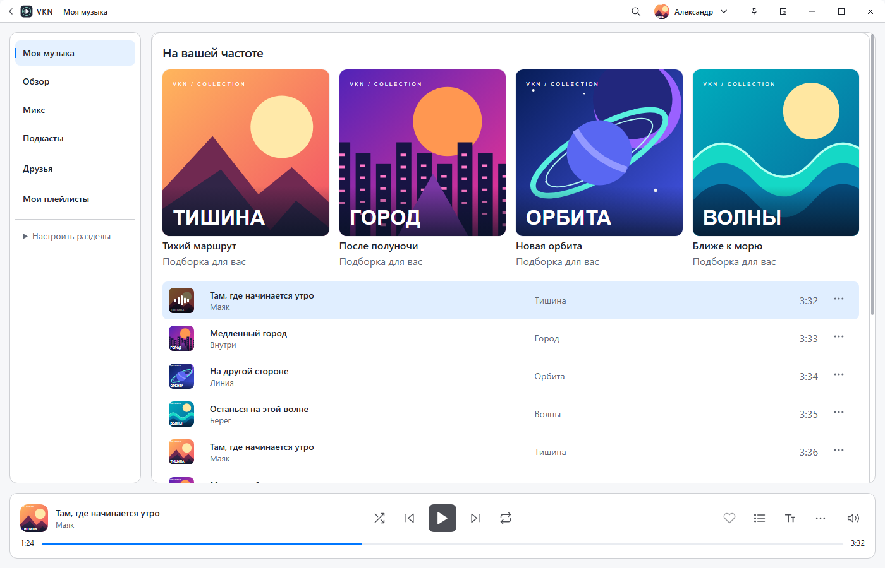

Большой плеер

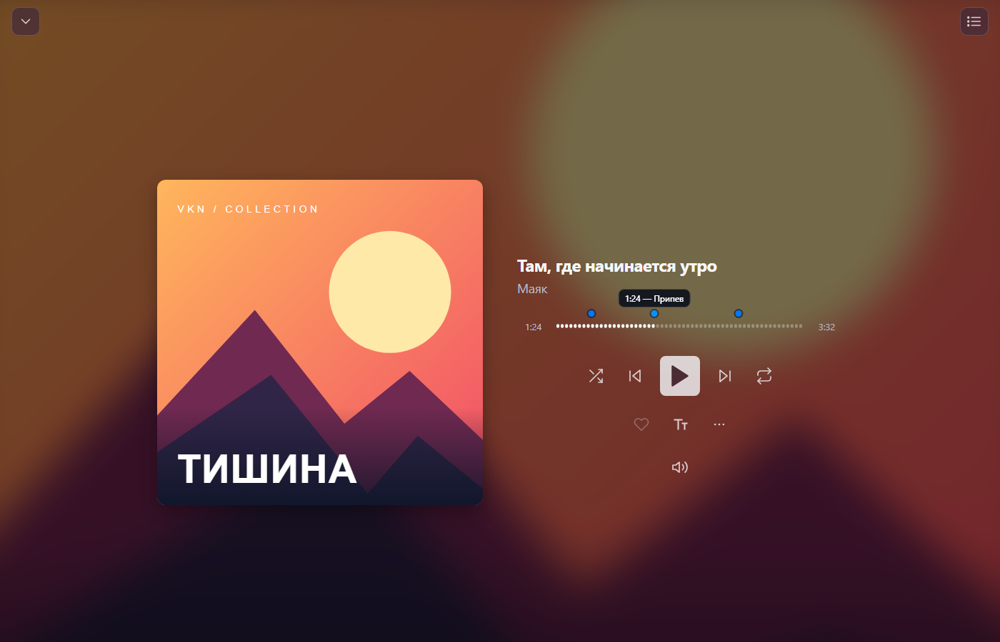

Закладки в большом плеере

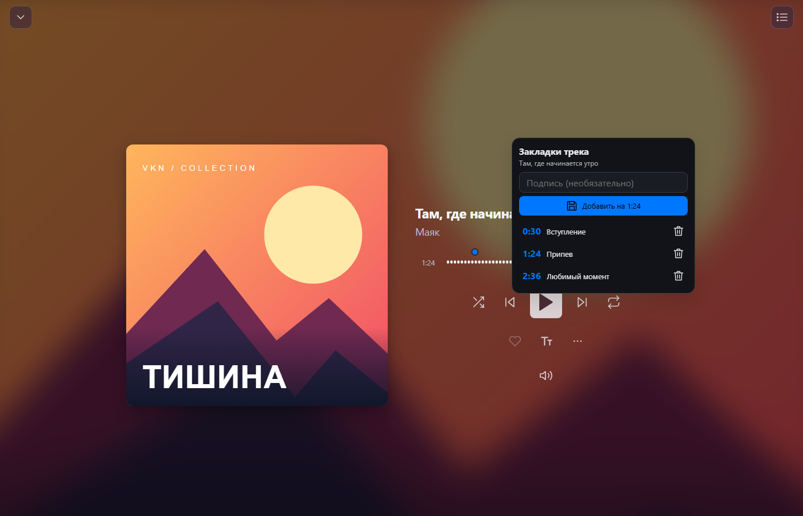

VKN Connect — выбор устройства

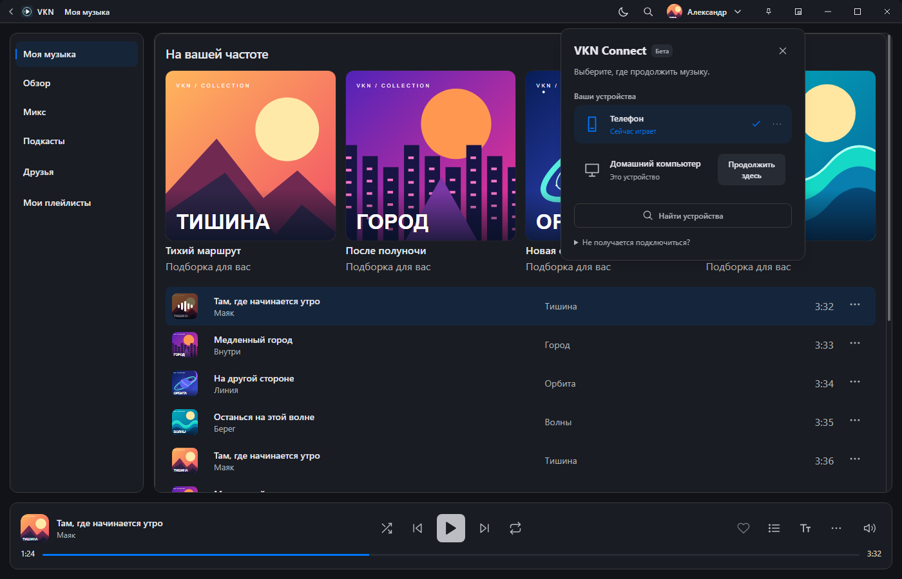

Сохранённая музыка без интернета

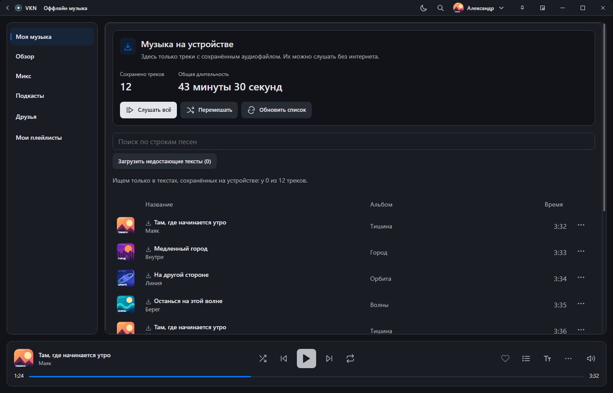

Страница альбома

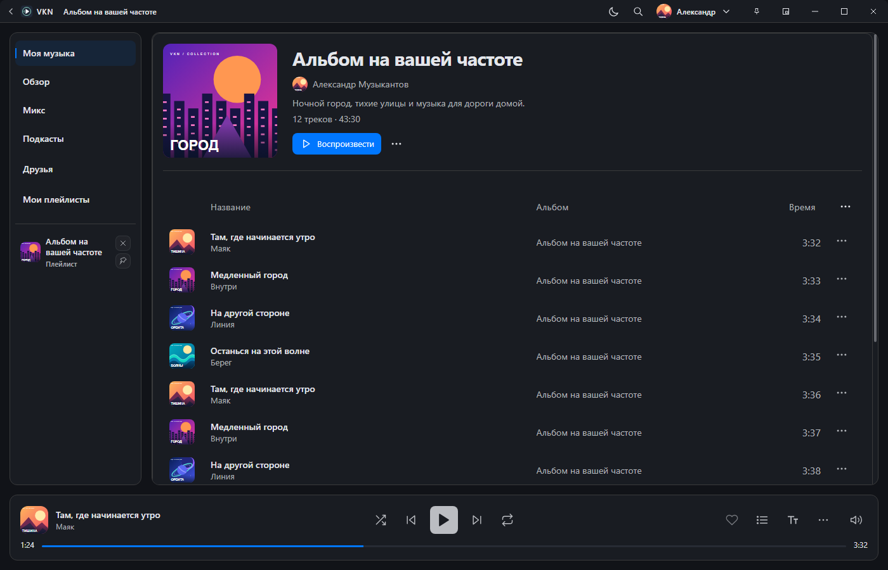

Профиль и закладки

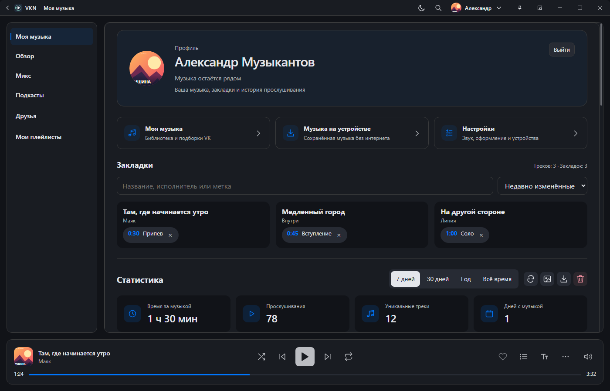

Эквалайзер

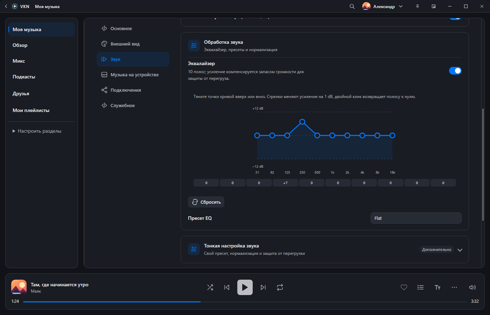

Очередь воспроизведения

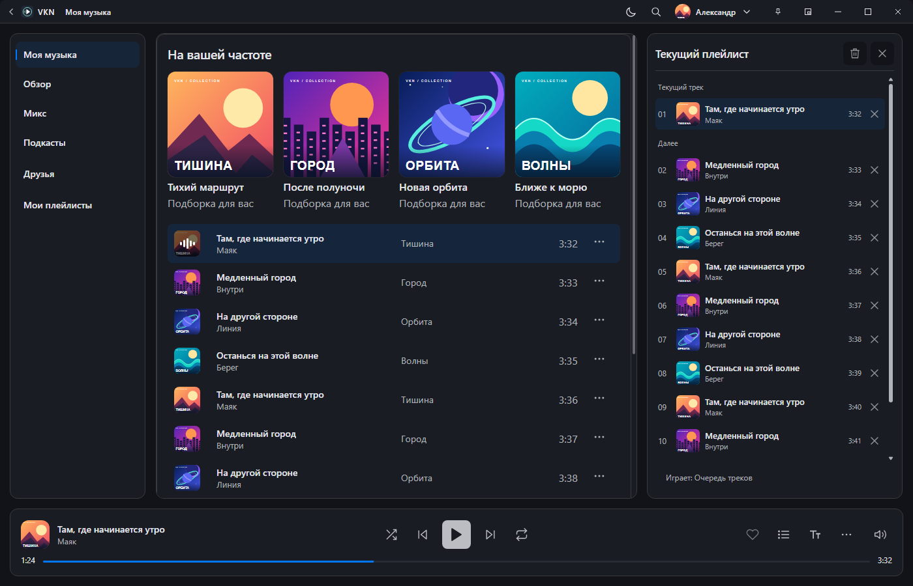

Вход по токену

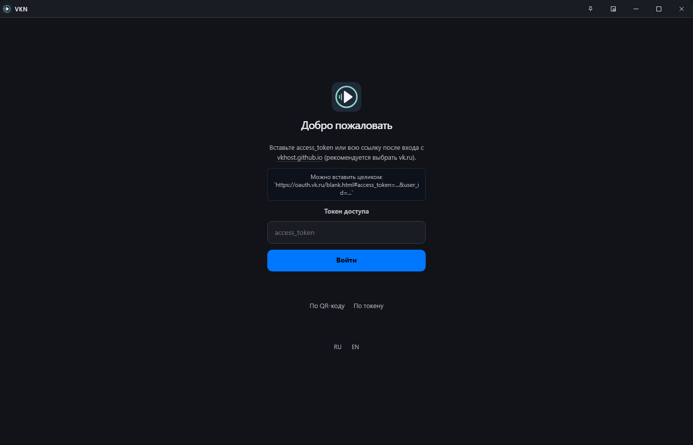

Статистика, которая остаётся на устройстве

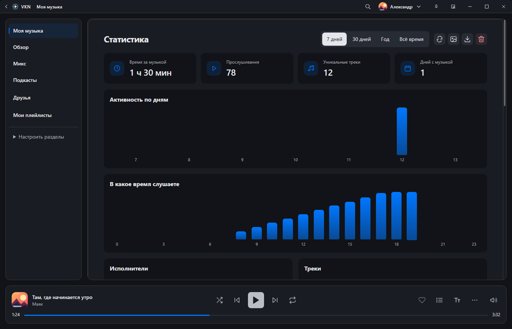

## Данные и автономность

Автор не собирает через VKN удалённую аналитику, телеметрию или историю прослушиваний. В приложение не встроена автоматическая отправка пользовательских данных на сервер автора.

VKN работает самостоятельно: запросы авторизации и музыки направляются непосредственно в VK, медиа загружаются с адресов, предоставленных сервисом.

Настройки, очередь, закрепления, локальная статистика и кэш остаются на вашем устройстве. Сессия текущего формата сохраняется с использованием системного защищённого хранилища Electron; остальные локальные данные не имеют общего шифрования. Локальная статистика включена по умолчанию и отключается в настройках хранения.

На Windows/Linux личные данные и настройки аккаунтов хранятся раздельно. В меню аккаунтов есть отдельное подтверждаемое действие «Удалить аккаунт и его данные»; обычное удаление сохранённого входа оставляет локальные данные. Явно экспортированные файлы нужно удалять самостоятельно.

При доступной сети VKN проверяет наличие нового стабильного релиза через GitHub. Компактная кнопка «Подробнее» в уведомлении открывает окно с изменениями и действием обновления. В «Настройки → Основное → Обновления» можно включить «Автообновление»: по умолчанию оно выключено и разрешает только фоновую загрузку. Установка и перезапуск запускаются отдельным нажатием, с необходимыми подтверждениями ОС. Windows portable и macOS требуют ручной замены скачанного приложения; установленная Windows-сборка открывает установщик, Android — системную установку APK, AppImage заменяет свой файл и перезапускается по кнопке. Для внешних средств AppImageUpdate рядом с AppImage публикуется `.zsync`. Токен VK, профиль и библиотека в запросах обновления не передаются.

При включении Discord выбранные сведения о прослушивании передаются клиенту Discord. При включении трансляции в VK сведения о текущем треке отправляются в VK. Диагностические логи выключены по умолчанию; экспорт сохраняет файл локально, а отправлять его автору решает пользователь.

Подробности о получателях, хранении, удалении и ограничениях защиты: **[PRIVACY.md](PRIVACY.md)**.

## Использование на свой риск

Приложение предоставляется «как есть», без обещаний бесперебойной работы, совместимости с будущими изменениями VK или отсутствия ошибок. Вы используете его на свой риск, в пределах, допускаемых применимым законодательством. Полные условия: **[TERMS.md](TERMS.md)**.

VKN — независимый проект, не официальный продукт VK. Название VKN используется как название проекта; зарегистрированный товарный знак не заявляется. Права на музыку, изображения, названия VK и другие сторонние материалы принадлежат соответствующим правообладателям.

## Разработка и вклад

Проект создаётся **gr4shin при значительном участии OpenAI Codex**. Большая часть реализации, рефакторинга и проверок выполняется с помощью ИИ; идея, направление развития, решения и выпуск — за gr4shin. Проект не представляется как работа, выполненная автором полностью в одиночку.

Codex используется при разработке. В установленный VKN не встроено взаимодействие с OpenAI или отправка ему данных пользователей.

Исходный код VKN пока закрыт. Этот GitHub-репозиторий содержит готовые релизы, описание, снимки интерфейса и документы для пользователей.

## Права и сторонние компоненты

© 2026 gr4shin. Все права на собственные материалы проекта сохранены. Условия использования официальных сборок: [LICENSE](LICENSE) и [TERMS.md](TERMS.md).

Сторонние компоненты распространяются по своим лицензиям, включая GPL-компонент FFmpeg: [THIRD_PARTY_NOTICES.md](THIRD_PARTY_NOTICES.md). Условия VKN не заменяют их лицензии.

## Сообщество

**[Присоединиться к Discord VKN](https://discord.gg/H7CePVp4vS)** — общение, помощь и обсуждение плеера.

На сервере есть русские и английские каналы, а также отдельные обсуждения Windows, Linux, macOS и Android. При вступлении выберите язык и платформу; изменить выбор можно в разделе Discord «Каналы и роли».

## Сообщить о проблеме

Откройте [Issue](https://github.com/gr4shin/vkn/issues) с версией, системой и шагами воспроизведения. Не публикуйте токены VK, QR-коды входа, файлы сессии или полные дампы аккаунта. Если решите приложить диагностический файл, сначала проверьте его содержимое: Issue и вложения могут быть публичными.
